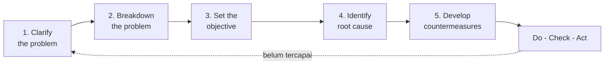

# Problem Solving Framework


[](https://github.com/harrisariefkamis/PROJECT-DATA-ANALYST)
[](https://github.com/harrisariefkamis/PROJECT-DATA-ANALYST/commits)
[](https://github.com/harrisariefkamis/PROJECT-DATA-ANALYST/stargazers)
[](https://github.com/harrisariefkamis/PROJECT-DATA-ANALYST/network/members)
[](https://github.com/harrisariefkamis/PROJECT-DATA-ANALYST/issues)


## Daftar Isi

- [Expected Outcome](#expected-outcome)
- [Outline](#outline)
- [Pengantar Singkat](#pengantar-singkat)
- [Problem = Gap](#problem--gap)
- [Framework dan Metode](#framework-dan-metode)
- [Alur Lima Langkah](#alur-lima-langkah)
- [Langkah 1: Clarify the Problem](#langkah-1--clarify-the-problem)
- [Langkah 2: Breakdown the Problem](#langkah-2--breakdown-the-problem)
- [Langkah 3: Target Setting](#langkah-3--target-setting-set-the-objective)
- [Langkah 4: Identify Root Cause](#langkah-4--identify-root-cause)
- [Langkah 5: Develop Countermeasures](#langkah-5--develop-countermeasures)
- [Setelah Plan: Do, Check, Act](#setelah-plan-do-check-act)
- [Contoh Kasus: Unilever](#contoh-kasus-unilever--penjualan-e-commerce)
- [Mini Task: Halojek](#mini-task-halojek-latihan)
- [Latihan dan Pengumpulan Hasil](#latihan-dan-pengumpulan-hasil)
- [Penutup](#penutup)
- [Referensi dan Sumber](#referensi-dan-sumber)

---

## Expected Outcome

Setelah menyelesaikan modul ini peserta akan:

- [ ] Memahami esensi permasalahan (*what is problem*) dan mampu mengkuantifikasi gap antara kondisi ideal dan aktual.
- [ ] Menguasai kerangka kerja pemecahan masalah (*problem solving framework*) dan langkah-langkah utamanya.
- [ ] Mampu menerapkan langkah: klarifikasi masalah, breakdown, target setting, identifikasi akar masalah, dan pengembangan countermeasure.
- [ ] Dapat membuat rencana tindakan yang terukur dan terprioritas berdasarkan analisis data.

---

## Outline

1. Definisi: apa itu problem? (Problem = Gap)
2. Problem solving frameworks umum (A3, DMAIC, Issue Tree, PDCA)
3. Fokus: PDCA dan langkah praktis pemecahan masalah
4. Langkah-langkah detail:
   - Clarify the problem
   - Breakdown the problem
   - Set the objective (target setting)
   - Define the root cause (root cause analysis)
   - Develop countermeasure (temporary vs permanent)
5. Contoh kasus dan latihan (Unilever, Halojek)
6. Template pekerjaan dan checklist data requirement

---

## Pengantar Singkat

Problem sering kali merupakan **gap** antara kondisi ideal dan kondisi aktual. Di banyak praktik industri (contoh: Toyota), problem dipandang sebagai peluang untuk melakukan perbaikan (*kaizen*). Tujuan proses problem solving adalah mengubah gap menjadi target tindakan yang jelas, terukur, dan berkelanjutan.

Referensi ringkas: pendekatan A3 dan PDCA dari Toyota, serta *Problem Solving 101* karya Ken Watanabe. Lihat [Referensi dan Sumber](#referensi-dan-sumber).

---

## Problem = Gap

Problem didefinisikan sebagai selisih (gap) antara kondisi ideal dan kondisi aktual.

| Komponen | Contoh |
|---|---|
| Ideal | Margin loss 0 pada akhir Q4'2022 |
| Existing | Loss -IDR 100 juta pada akhir Q3'2022 |
| **Gap** | **IDR 100 juta** |

> Problem yang baik dapat **dikuantifikasi** dan **divisualisasikan**.

---

## Framework dan Metode

| Metode | Keterangan |
|---|---|
| **A3 Problem Solving** | Pendekatan Toyota yang merangkum masalah, analisis, dan rencana tindakan dalam satu lembar |
| **DMAIC** | Define, Measure, Analyze, Improve, Control (Six Sigma) |
| **Issue Tree / Logic Tree** | Memecah masalah besar menjadi cabang-cabang yang lebih kecil |
| **PDCA** | Plan, Do, Check, Act: siklus perbaikan berulang |

Modul ini fokus pada **PDCA** dan langkah-langkah praktis yang *actionable*.

---

## Alur Lima Langkah



Kelima langkah ini adalah tahap **Plan** dari PDCA.

---

## Langkah 1: Clarify the Problem

**Tujuan:** membuat masalah jelas, terukur, dan terdefinisi agar semua pihak *on the same page*.

**Checklist:**

- [ ] **Ideal condition:** apa target atau kondisi yang diharapkan?
- [ ] **Existing condition:** apa yang sedang terjadi sekarang?
- [ ] **Gap:** berapa besar perbedaannya (kuantifikasi)?
- [ ] **Stakeholder:** siapa user/pemilik masalah?

**Tips:**

- Konfirmasi dan selaraskan dengan business user.
- Buat asumsi serendah mungkin. Bila subjektif, cari benchmark atau tetapkan threshold.

**Contoh (cafe):**

- Ideal: loss = 0 pada akhir Q4'2022
- Existing: loss = -IDR 100 juta pada akhir Q3'2022
- Gap: IDR 100 juta

**Contoh soal:** Anda manager rumah sakit dan merasa ruangan lebih penuh padahal pasien tercatat stabil. Formulasikan ideal, existing, dan gap.

---

## Langkah 2: Breakdown the Problem

**Tujuan:** memecah gap menjadi komponen operasional yang lebih kecil dan dapat diukur.

**Panduan:**

- Gunakan **4W**: What? Where? When? Who?
- Pecah gap ke komponen biaya, area, produk, channel, dan sebagainya.
- Tentukan prioritas berdasarkan **impact** dan **urgensi**.

**Contoh:**

| Komponen | Nilai | Kontribusi ke gap |
|---|---|---|
| Labor cost | IDR 70 juta | 70% |
| Operational cost | IDR 30 juta | 30% |
| **Total gap** | **IDR 100 juta** | 100% |

Fokus ke labor cost terlebih dahulu karena kontribusinya terbesar.

---

## Langkah 3: Target Setting (Set the Objective)

**Tujuan:** menetapkan target konkret dan terukur (*how much* dan *by when*).

**Contoh target:**

- Mengurangi labor cost sebesar IDR 30 juta sebelum akhir Q4.
- Meningkatkan konversi funnel "consider → purchase" untuk produk Energy Drink sebesar 5% dalam 3 bulan.

**Tips:** gunakan target **SMART**.

| Huruf | Arti |
|---|---|
| S | Specific |
| M | Measurable |
| A | Achievable |
| R | Relevant |
| T | Time-bound |

---

## Langkah 4: Identify Root Cause

**Tujuan:** menemukan penyebab utama yang secara langsung menyumbang gap.

**Metode:**

- **5 Whys:** ulangi pertanyaan "mengapa" sampai akar masalah ditemukan.
- **Fishbone / Ishikawa:** kelompokkan kemungkinan penyebab: Man, Machine, Method, Material, Measurement, Mother Nature/Market.
- **Analisis data:** segmentation, cohort, channel, time-series.

**Contoh:** mengapa conversion rendah pada Energy Drink?

1. Harga terlalu tinggi setelah ongkir
2. Promo tidak sampai ke target audience
3. Deskripsi produk tidak jelas pada halaman produk

> Daftar di atas adalah **hipotesis**. Buktikan dengan data sebelum menyimpulkan.

---

## Langkah 5: Develop Countermeasures

**Tujuan:** menghasilkan solusi sementara (*temporary*) dan solusi permanen yang mengeliminasi root cause.

| Tipe | Fungsi | Contoh |
|---|---|---|
| **Temporary** | Memulihkan kondisi jangka pendek | Fallback promo, manual override |
| **Permanent** | Memperbaiki akar masalah agar tidak terulang | Perbaikan promo engine, redesign funnel |

**Kriteria pemilihan solusi:**

- **Feasibility:** bisa dilaksanakan?
- **Cost:** berapa biayanya?
- **Impact:** seberapa besar menutup gap?
- **Practicality & Safety:** aman dan masuk akal?

Prioritaskan solusi berdasarkan kombinasi **impact x effort**.

---

## Setelah Plan: Do, Check, Act

> *Tambahan revisi.* Lima langkah di atas baru mencakup tahap **Plan**. Agar siklus PDCA lengkap, lanjutkan dengan tiga tahap berikut.

| Tahap PDCA | Aktivitas |
|---|---|
| **Plan** | Langkah 1-5 di atas |
| **Do** | Jalankan countermeasure sesuai rencana dan catat hasilnya |
| **Check** | Bandingkan hasil dengan target. Evaluasi hasil **dan** prosesnya |
| **Act** | Jika berhasil, standarkan (SOP, dokumentasi). Jika belum, ulangi dari klarifikasi masalah |

---

## Contoh Kasus: Unilever, Penjualan E-commerce

**Kasus singkat:**

| Komponen | Nilai |
|---|---|
| Target profit e-commerce 2020 | IDR 50 bio |
| Achievement | IDR 20 bio |
| **Gap** | **IDR 30 bio** |

Breakdown by product segment: **Energy Drink menyumbang 50% dari gap** (sekitar IDR 15 bio).

**Langkah tugas:**

1. Quantify gap per segment (gunakan data sales per segment).
2. Fokus pada customer journey: identifikasi tahap drop-off (awareness → consider → buy → purchase).
3. Set target: perbaiki conversion "consider → purchase" untuk Energy Drink sehingga menambah IDR 15 bio profit by Q3'2024.
4. Hipotesis root cause: harga + ongkir, promo targeting, product bundling.
5. Develop countermeasures: optimalkan promo targeting, bundle products, review shipping fees.

> **Catatan revisi:** kasus ini berbasis tahun 2020, tetapi target tertulis Q3'2024. Sesuaikan tahunnya jika itu salah ketik.

**Data requirement (minimal):**

- [ ] Target dan achievement sales per segment
- [ ] Funnel conversion per segment
- [ ] Survey/qualitative feedback untuk validasi hipotesis

---

## Mini Task: Halojek (Latihan)

**Kasus:**

- Halojek memiliki 2 produk: Halofood dan Haloride.
- Revenue Q3'23 turun 50% vs Q3'22.

| Biaya (Bio) | Q3'22 | Q3'23 |
|---|---|---|
| Marketing | 600 | 800 |
| Labor | 600 | 750 |
| Infra | 2,000 | 3,500 |

**Tugas:**

- [ ] **1.** Develop problem solving framework untuk menelusuri kenaikan cost di Q3'23.
- [ ] **2.** Jelaskan data requirement untuk analisis lebih lanjut.
- [ ] **3.** Berikan 2-3 alternatif countermeasures sementara dan permanen.

<details>
<summary>Petunjuk perhitungan awal (untuk langkah breakdown)</summary>

| Komponen | Q3'22 | Q3'23 | Selisih | Perubahan |
|---|---|---|---|---|
| Marketing | 600 | 800 | +200 | +33.3% |
| Labor | 600 | 750 | +150 | +25.0% |
| Infra | 2,000 | 3,500 | +1,500 | +75.0% |
| **Total** | **3,200** | **5,050** | **+1,850** | **+57.8%** |

Infra menyumbang sekitar 81% dari kenaikan total biaya (1,500 dari 1,850). Revenue turun sementara biaya naik, jadi perlu juga dilihat per produk (Halofood vs Haloride) dan per bulan.

</details>

**Template jawaban (singkat):**

```text
Ideal condition                      :
Existing condition                   :
Gap (kuantifikasi)                   :
Breakdown (by cost/area/product)     :
Objective (target)                   :
Hypotheses root cause                :
Countermeasures (temporary/permanent):
```

---

## Latihan dan Pengumpulan Hasil

- Simpan jawaban di `01-on-boarding/exercises/problem-solving/` sebagai file markdown (`answer_<nama>.md`).
- Sertakan data requirement dan langkah analisis singkat yang akan dilakukan untuk membuktikan hipotesis.

---

## Penutup

Problem solving yang efektif dimulai dengan klarifikasi masalah yang tepat, breakdown yang terukur, dan hipotesis yang dapat diuji. Gunakan data sebagai sumber kebenaran, dan pilih countermeasure berdasarkan kombinasi impact dan effort.

---

## Referensi dan Sumber

### Buku

- Sobek II, D. K., dan Smalley, A. (2008). *Understanding A3 Thinking: A Critical Component of Toyota's PDCA Management System*. Productivity Press. [Halaman buku di Routledge](https://www.routledge.com/Understanding-A3-Thinking-A-Critical-Component-of-Toyotas-PDCA-Management/Sobek-II-Smalley/p/book/9780429244964)
- Watanabe, K. (2009). *Problem Solving 101: A Simple Book for Smart People*. Portfolio. ISBN 978-1-59184-242-2. [Apple Books](https://books.apple.com/us/book/id357916517)

### Topik terkait

- Toyota Business Practice: pendekatan problem solving Toyota yang langkah-langkahnya sejalan dengan struktur modul ini (clarify, breakdown, target, root cause, countermeasure, lalu implementasi dan evaluasi). Cari lewat buku *The Toyota Way* (Jeffrey Liker) atau materi *Toyota Business Practice*.
- [ASQ: DMAIC](https://asq.org/quality-resources/dmaic)
- [ASQ: PDCA cycle](https://asq.org/quality-resources/pdca-cycle)
- [ASQ: Five Whys](https://asq.org/quality-resources/five-whys)
- [ASQ: Fishbone diagram](https://asq.org/quality-resources/fishbone)

### Repo terkait

- [harrisariefkamis/PROJECT-DATA-ANALYST](https://github.com/harrisariefkamis/PROJECT-DATA-ANALYST): roadmap belajar 17 modul

> Halaman buku di Routledge dan Apple Books sudah dicek lewat pencarian. Link ASQ dan rujukan Toyota Business Practice ditulis dari ingatan, jadi cek ulang jika tidak terbuka. Badge GitHub dinamis baru tampil setelah file di-push dan repo-nya publik.
