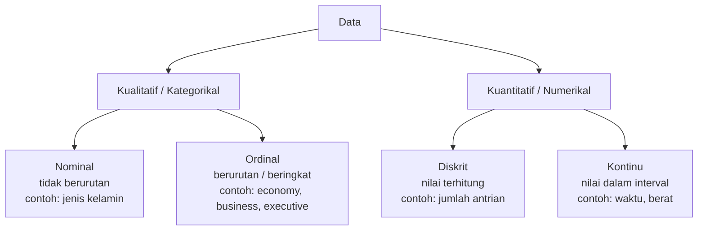

# Statistik: Pengantar, Ukuran Pemusatan dan Penyebaran


[](https://github.com/harrisariefkamis/PROJECT-DATA-ANALYST)
[](https://github.com/harrisariefkamis/PROJECT-DATA-ANALYST/commits)
[](https://github.com/harrisariefkamis/PROJECT-DATA-ANALYST/stargazers)
[](https://github.com/harrisariefkamis/PROJECT-DATA-ANALYST/network/members)
[](https://github.com/harrisariefkamis/PROJECT-DATA-ANALYST/issues)


> Badge GitHub dinamis mengarah ke repo roadmap utama. Jika modul ini ada di repo milikmu sendiri, ganti `harrisariefkamis/PROJECT-DATA-ANALYST` dengan `USERNAME/REPO`.
> Gambar studi kasus ada di folder `images/`. Simpan folder itu sejajar dengan file ini agar gambar tampil di GitHub.

## Daftar Isi

- [Expected Outcome](#expected-outcome)
- [Outline](#outline)
- [1. Pengantar Statistika](#1-pengantar-statistika)
- [2. Tipe-Tipe Data](#2-tipe-tipe-data)
- [3. Ukuran Pemusatan](#3-ukuran-pemusatan-measure-of-central-tendency)
- [4. Ukuran Penyebaran](#4-ukuran-penyebaran-measure-of-dispersion)
- [5. Z-score: Contoh Interpretasi](#5-z-score-contoh-interpretasi)
- [6. Outlier](#6-outlier-pencilan)
- [7. Langkah Praktis Analisis Statistik](#7-langkah-praktis-analisis-statistik)
- [8. Latihan](#8-latihan-praktik)
- [9. Ringkasan](#9-ringkasan)
- [Referensi dan Sumber](#referensi-dan-sumber)

---

## Expected Outcome

- [ ] Memahami konsep dasar statistika untuk analisis data.
- [ ] Memahami ukuran pemusatan (*measure of central tendency*) dan ukuran penyebaran (*measure of dispersion*).
- [ ] Dapat menghitung dan menginterpretasikan mean, median, mode, range, variance, standar deviasi, dan z-score.
- [ ] Paham tipe data dan kapan menggunakan ukuran statistik tertentu.

> **Catatan istilah:** di materi ini ukuran pemusatan disebut *measure of centric* dan ukuran penyebaran disebut *measure of distribution*. Istilah baku di literatur adalah *measure of central tendency* dan *measure of dispersion (spread)*. Pakai istilah baku saat mencari referensi.

---

## Outline

1. Pengantar statistika
2. Tipe data
3. Ukuran pemusatan (Mean, Median, Mode, Range)
4. Ukuran penyebaran (Variance, Standard Deviation, Z-score, Quartile, IQR)
5. Contoh kasus dan perhitungan (dataset warung gorengan)
6. Latihan dan referensi

---

## 1. Pengantar Statistika

Statistika berkaitan dengan cara pengumpulan, pengolahan, analisis, dan penarikan kesimpulan atas data. Statistika menyajikan ukuran-ukuran yang memudahkan kita memahami karakteristik sekumpulan data (misalnya jumlah kasus positif per hari).

---

## 2. Tipe-Tipe Data



Pemilihan statistik tergantung tipe data. Misalnya, mean hanya cocok untuk data numerik.

| Tipe data | Ukuran yang cocok |
|---|---|
| Nominal | Mode, frekuensi |
| Ordinal | Mode, median |
| Diskrit / Kontinu | Mean, median, mode, range, variance, std dev, kuartil |

---

## 3. Ukuran Pemusatan (Measure of Central Tendency)

Memberi gambaran di mana data "terkumpul".

| Ukuran | Definisi | Catatan |
|---|---|---|
| **Mean** (rata-rata) | mean = (Σ xᵢ) / n | Sensitif terhadap outlier |
| **Median** (nilai tengah) | Nilai tengah setelah data diurutkan. Untuk n ganjil, posisi = (n + 1) / 2 | Tidak sensitif terhadap outlier |
| **Mode** (modus) | Nilai yang paling sering muncul | Bisa tidak ada, atau lebih dari satu |
| **Range** (jangkauan) | max(data) − min(data) | Gambaran sebaran kasar |

### Studi kasus: pelanggan Warung A selama 15 hari

Data asli (urutan hari 1 sampai 15):

```text
26, 37, 76, 49, 95, 69, 83, 87, 39, 95, 59, 83, 83, 87, 46
```

Setelah diurutkan:

```text
26, 37, 39, 46, 49, 59, 69, 76, 83, 83, 83, 87, 87, 95, 95
```


**Perhitungan:**

| Ukuran | Perhitungan | Hasil |
|---|---|---|
| Mean | 1.014 / 15 | **67,6** |
| Median | nilai ke-8 (n = 15) | **76** |
| Mode | muncul 3 kali | **83** |
| Range | 95 − 26 | **69** |


**Interpretasi:**

- Mean (67,6) lebih kecil dari median (76). Ini menandakan ada beberapa hari dengan pelanggan sangat sedikit (misalnya 26 dan 37) yang menarik mean ke bawah, sehingga distribusi sedikit **miring ke kiri**.
- Median (76) adalah gambaran nilai tengah yang lebih tahan terhadap hari-hari ekstrem.
- Modus (83) menunjukkan jumlah pelanggan harian yang paling sering terjadi.

---

## 4. Ukuran Penyebaran (Measure of Dispersion)

Mengukur seberapa tersebar data di sekitar pusat.

| Ukuran | Rumus | Catatan |
|---|---|---|
| **Variance** (sampel) | S² = Σ(xᵢ − x̄)² / (n − 1) | Dipakai untuk inferensi dari sampel ke populasi |
| **Variance** (populasi) | σ² = Σ(xᵢ − μ)² / n | Dipakai jika data adalah seluruh populasi |
| **Standard deviation** | √variance | Satuan sama dengan data asli, mudah diinterpretasikan |
| **Z-score** | Z = (X − μ) / σ | Jarak observasi dari mean dalam satuan std dev |
| **Quartile** | Q1 (bawah), Q2 (median), Q3 (atas) | Membagi data terurut menjadi 4 bagian |
| **IQR** | Q3 − Q1 | Dasar identifikasi outlier (batas 1,5 × IQR) |

Z-score berguna untuk membandingkan nilai antar distribusi berbeda dan mendeteksi outlier.

### Perhitungan pada dataset Warung A

| Besaran | Hasil |
|---|---|
| Σ(xᵢ − mean)² | 7.409,6 |
| Variance sampel (n − 1 = 14) | ≈ 529,26 |
| Std dev sampel | ≈ **23,01** |
| Variance populasi (n = 15) | ≈ 493,97 |
| Std dev populasi | ≈ 22,23 |
| Q1 (nilai ke-4) | **46** |
| Q2 (median) | **76** |
| Q3 (nilai ke-12) | **87** |
| IQR | 87 − 46 = **41** |


> **Catatan metode kuartil:** nilai Q1 = 46 dan Q3 = 87 memakai metode posisi (n + 1) / 4. Fungsi `QUARTILE` di Google Sheets dan Excel (serta `numpy.percentile` secara default) memakai interpolasi dan menghasilkan **Q1 = 47,5, Q2 = 76, Q3 = 85, IQR = 37,5** untuk data yang sama. Kedua metode sah, tetapi sebutkan metode yang dipakai agar hasilnya bisa direproduksi.

---

## 5. Z-score: Contoh Interpretasi

### Contoh 1: nilai ujian

Ali mendapat nilai 90. Rata-rata kelas 75 dan std dev 8.

```text
Z = (90 − 75) / 8 = 1,875
```

Ali berada sekitar 1,875 std dev di atas mean. Dengan asumsi distribusi normal, ini setara persentil sekitar **97%**.

### Contoh 2: membandingkan dua area

| Area | μ | σ | Nilai (X) | Z-score |
|---|---|---|---|---|
| Jawa Barat (Bejo) | 50.000.000 | 5.000.000 | 55.000.000 | **1,000** |
| DKI Jakarta (Udin) | 60.000.000 | 8.000.000 | 65.000.000 | **0,625** |


**Interpretasi:** meskipun nilai Udin lebih besar secara absolut, relatif terhadap area masing-masing performa Bejo (Z = 1,0) lebih baik daripada Udin (Z = 0,625).

---

## 6. Outlier (Pencilan)

**Penyebab:** kesalahan input, kesalahan pengukuran, sampling, kejadian alami, dan lain-lain.

**Deteksi umum:**

- Nilai di luar [Q1 − 1,5 × IQR, Q3 + 1,5 × IQR]
- Z-score absolut > 3 (dengan asumsi distribusi normal)

**Pada dataset Warung A:**

| Metode | Batas bawah | Batas atas | Outlier? |
|---|---|---|---|
| IQR (Q1 = 46, Q3 = 87) | −15,5 | 148,5 | Tidak ada |
| Z-score (std dev sampel 23,01) | z < −3 | z > 3 | Tidak ada (z terkecil −1,81, z terbesar 1,19) |

---

## 7. Langkah Praktis Analisis Statistik

1. Visualisasi ringkas (histogram, boxplot).
2. Hitung ukuran pemusatan dan penyebaran (mean, median, std dev, IQR).
3. Identifikasi outlier dan tentukan aksi (hapus, impute, atau investigasi).
4. Segmentasi dan bandingkan kelompok (mean per grup, z-score).
5. Laporkan temuan dengan interpretasi dan rekomendasi.

---

## 8. Latihan (Praktik)

- [ ] **1.** Gunakan dataset warung gorengan untuk menghitung: mean, median, mode, range, variance (sampel), std dev (sampel), Q1/Q2/Q3, IQR, dan deteksi outlier.
- [ ] **2.** Hitung z-score untuk nilai 95 pada dataset, lalu interpretasikan apakah nilai 95 termasuk outlier.
- [ ] **3.** Bandingkan median vs mean: apa artinya jika mean jauh berbeda dari median?
- [ ] **4.** (Opsional) Isi dan rapikan latihan di [Google Sheets latihan](https://docs.google.com/spreadsheets/d/1rU4L4DTFjbjjgih3bUuN09fuhaEbR_efyrj6iJO0EoE/edit#gid=1673476200).

### Fungsi Google Sheets yang berguna

| Ukuran | Fungsi |
|---|---|
| Mean | `=AVERAGE(range)` |
| Median | `=MEDIAN(range)` |
| Mode | `=MODE(range)` |
| Range | `=MAX(range)-MIN(range)` |
| Variance sampel / populasi | `=VAR.S(range)` / `=VAR.P(range)` |
| Std dev sampel / populasi | `=STDEV.S(range)` / `=STDEV.P(range)` |
| Kuartil | `=QUARTILE(range, 1)` untuk Q1, `2` untuk Q2, `3` untuk Q3 |
| Z-score | `=STANDARDIZE(x, mean, stdev)` |

<details>
<summary>Kunci jawaban latihan (buka setelah mencoba sendiri)</summary>

**Nomor 1:** mean 67,6; median 76; mode 83; range 69; variance sampel ≈ 529,26; std dev sampel ≈ 23,01; Q1 = 46, Q2 = 76, Q3 = 87 (metode posisi); IQR = 41; batas outlier [−15,5; 148,5], sehingga tidak ada outlier.

**Nomor 2:** z = (95 − 67,6) / 23,01 ≈ **1,19**. Nilai 95 berada sekitar 1,19 std dev di atas mean, jauh di bawah ambang |z| > 3, jadi **bukan outlier**. Nilai 95 juga muncul dua kali dan sama dengan nilai maksimum.

**Nomor 3:** mean yang jauh berbeda dari median menandakan distribusi miring (skewed) atau ada outlier. Mean < median berarti ekor panjang di sisi nilai kecil (miring ke kiri). Mean > median berarti ekor panjang di sisi nilai besar (miring ke kanan). Pada kasus seperti ini, median biasanya lebih representatif.

</details>

---

## 9. Ringkasan

- Ukuran pemusatan menjelaskan titik tengah data (mean, median, mode, range).
- Ukuran penyebaran menjelaskan sebaran data (variance, std dev, IQR, z-score).
- Pilih ukuran yang sesuai berdasarkan tipe data dan tujuan analisis.
- Gunakan visualisasi sederhana untuk membantu interpretasi.

---

## Referensi dan Sumber

### Sumber materi dan data

- Materi internal modul Statistics.
- Dataset: jumlah pelanggan Warung A selama 15 hari (data contoh dari modul).
- Gambar pada folder `images/` dibuat dari dataset di atas menggunakan Python (matplotlib, SciPy).
- [Google Sheets latihan](https://docs.google.com/spreadsheets/d/1rU4L4DTFjbjjgih3bUuN09fuhaEbR_efyrj6iJO0EoE/edit#gid=1673476200)

### Belajar statistik (gratis)

- [Khan Academy: Statistics and probability](https://www.khanacademy.org/math/statistics-probability)
- [OpenIntro Statistics](https://www.openintro.org/book/os/): buku teks statistik gratis
- [NIST/SEMATECH e-Handbook of Statistical Methods](https://www.itl.nist.gov/div898/handbook/)
- [Think Stats](https://github.com/AllenDowney/ThinkStats): statistik dengan pendekatan pemrograman (repo GitHub)
- [An Introduction to Statistical Learning](https://www.statlearning.com)

### Dokumentasi tools

- [Google Sheets function list](https://support.google.com/docs/table/25273)
- [NumPy: percentile](https://numpy.org/doc/stable/reference/generated/numpy.percentile.html)
- [SciPy: scipy.stats](https://docs.scipy.org/doc/scipy/reference/stats.html)
- [pandas: describe](https://pandas.pydata.org/docs/reference/api/pandas.DataFrame.describe.html)

### Repo terkait

- [harrisariefkamis/PROJECT-DATA-ANALYST](https://github.com/harrisariefkamis/PROJECT-DATA-ANALYST): roadmap belajar 17 modul
