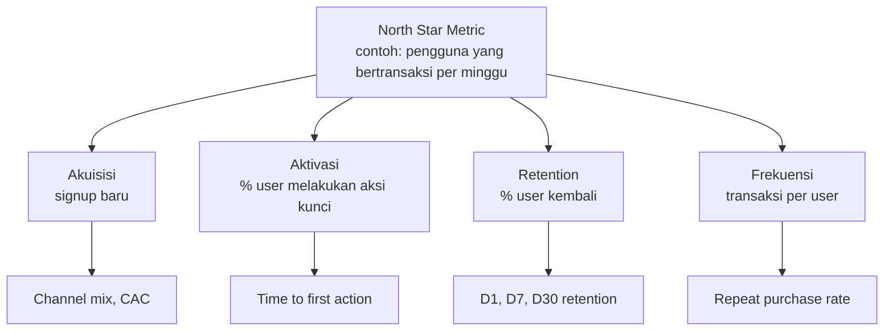

# Measure What Matters: Metrics untuk Product dan Analytics Team

[](https://github.com/harrisariefkamis/PROJECT-DATA-ANALYST)
[](https://github.com/harrisariefkamis/PROJECT-DATA-ANALYST/commits)
[](https://github.com/harrisariefkamis/PROJECT-DATA-ANALYST/stargazers)
[](https://github.com/harrisariefkamis/PROJECT-DATA-ANALYST/network/members)
[](https://github.com/harrisariefkamis/PROJECT-DATA-ANALYST/issues)


> Gambar ada di folder `images/` dan contoh query ada di folder `sql/`. Simpan keduanya sejajar dengan file ini.
> **Semua angka pada gambar dan tabel studi kasus berasal dari data simulasi** untuk ilustrasi, bukan data perusahaan nyata.

## Daftar Isi

- [Key Idea](#key-idea)
- [Vanity vs Actionable Metrics](#vanity-vs-actionable-metrics)
- [Karakteristik Metrik yang Baik](#karakteristik-metrik-yang-baik)
- [Frameworks](#frameworks)
- [Metric Spec](#metric-spec-satu-halaman-per-metrik)
- [Studi Kasus dan Contoh SQL](#studi-kasus-dan-contoh-sql)
- [Next Steps untuk Tim](#next-steps-untuk-tim)
- [Latihan](#latihan)
- [Referensi dan Sumber](#referensi-dan-sumber)

---

## Key Idea

Fokus pada **sedikit metrik yang actionable**: satu *North Star Metric* ditambah beberapa *supporting metrics*. Hindari *vanity metrics*, yaitu angka yang enak dilaporkan tetapi tidak membantu mengambil keputusan.

---

## Vanity vs Actionable Metrics

| | Vanity metric | Actionable metric |
|---|---|---|
| Contoh | Total registered users, total page views, total download | DAU/WAU, retention, conversion rate, revenue per user |
| Perilaku angka | Cenderung naik terus | Naik dan turun mengikuti perilaku nyata |
| Bisa memicu tindakan? | Sulit | Ya, jelas apa yang perlu dicek atau diperbaiki |


**Cara membaca gambar:** total registered users naik terus karena angkanya kumulatif, bahkan saat kampanye berbayar menambah banyak signup. DAU hampir tidak ikut naik, artinya user baru dari kampanye itu belum menjadi pengguna aktif. Hanya DAU yang memberi sinyal untuk bertindak.

---

## Karakteristik Metrik yang Baik

| Karakteristik | Pertanyaan uji |
|---|---|
| **Relevant** | Apakah metrik ini terhubung ke tujuan bisnis atau produk? |
| **Actionable** | Jika angkanya berubah, apakah tim tahu apa yang harus dilakukan? |
| **Measurable & reliable** | Apakah datanya bisa dihitung secara konsisten dan akurat? |
| **Understandable** | Apakah semua stakeholder paham artinya tanpa penjelasan panjang? |
| **Sensitive & timely** | Apakah metrik bereaksi terhadap perubahan dan tersedia cukup cepat untuk keputusan? |

---

## Frameworks

### 1. North Star Metric

Satu metrik utama yang paling mewakili nilai yang diterima pengguna dari produk, didukung beberapa *input metrics* yang bisa dipengaruhi tim.



> Contoh North Star di atas hanya ilustrasi. Pilih North Star yang sesuai dengan nilai inti produkmu.

### 2. AARRR (Pirate Metrics)

| Tahap | Pertanyaan | Contoh metrik |
|---|---|---|
| **A**cquisition | Dari mana user datang? | Signup, cost per acquisition per channel |
| **A**ctivation | Apakah user merasakan nilai awal produk? | % user menyelesaikan aksi kunci |
| **R**etention | Apakah user kembali? | D1/D7/D30 retention, DAU/MAU |
| **R**eferral | Apakah user mengajak orang lain? | Jumlah undangan, referral rate |
| **R**evenue | Apakah user menghasilkan pendapatan? | Conversion rate, ARPU |


Pada data simulasi ini, 55% user melakukan aksi kunci (activation), tetapi hanya sekitar 16% yang aktif lagi di hari ke-7 dan sekitar 6% yang membeli dalam 7 hari. Penurunan terbesar setelah activation adalah titik yang paling layak diselidiki lebih dulu. Tahap AARRR tidak selalu berurutan, jadi setiap bar dihitung terhadap total signup.

### 3. HEART

Kerangka dari Google untuk metrik pengalaman pengguna, dipakai bersama proses **Goals, Signals, Metrics**.

| Dimensi | Arti | Contoh sinyal/metrik |
|---|---|---|
| **H**appiness | Sikap dan kepuasan | Skor kepuasan, NPS |
| **E**ngagement | Tingkat keterlibatan | Sesi per user per minggu |
| **A**doption | Pengguna baru fitur/produk | Jumlah user baru yang memakai fitur |
| **R**etention | Pengguna yang bertahan | % user aktif setelah 30 hari |
| **T**ask success | Keberhasilan menyelesaikan tugas | Completion rate, error rate, waktu penyelesaian |

Tidak semua dimensi perlu dipakai. Pilih yang relevan dengan tujuan produk atau fitur.

---

## Metric Spec (Satu Halaman per Metrik)

Dokumentasikan setiap metrik agar definisinya sama di seluruh tim: **nama, definisi, SQL/formula, time grain, dimensions, owner**.

| Field | Contoh: D7 Retention |
|---|---|
| Nama | D7 Retention |
| Definisi | % user dalam satu cohort signup yang punya minimal satu sesi tepat 7 hari setelah tanggal signup |
| Formula | `retained_d7 / cohort_size` |
| Sumber data | Tabel `events` (`signup`, `session`) |
| Time grain | Harian (per tanggal signup), dilaporkan per cohort mingguan |
| Dimensions | Channel, platform, negara |
| Aturan khusus | Hanya cohort yang sudah genap 7 hari, zona waktu UTC |
| Owner | Product Analytics |

Template kosong untuk disalin:

```text
Nama           :
Definisi       :
Formula / SQL  :
Sumber data    :
Time grain     :
Dimensions     :
Aturan khusus  :
Owner          :
```

---

## Studi Kasus dan Contoh SQL

### Skema data simulasi

| Tabel | Kolom | Keterangan |
|---|---|---|
| `users` | `user_id`, `channel`, `signup_date` | Satu baris per user. Channel: organic, paid, referral |
| `events` | `user_id`, `event_name`, `event_date` | Event: `signup`, `activate`, `session`, `invite`, `purchase` |

Data simulasi: 3.736 user yang signup pada 5 Jan sampai 1 Mar 2026, dengan kampanye paid pada awal Februari. Query di bawah memakai sintaks **PostgreSQL**. Logika ketiganya sudah saya jalankan pada data simulasi dengan padanan sintaks SQLite. Sintaks PostgreSQL-nya belum dijalankan langsung.

### 1. DAU (Daily Active Users)

```sql
SELECT
  event_date AS day,
  COUNT(DISTINCT user_id) AS dau
FROM events
WHERE event_name = 'session'
GROUP BY 1
ORDER BY 1;
```

### 2. Retention cohort (day-7)

```sql
WITH signups AS (
  SELECT user_id, event_date AS signup_date
  FROM events
  WHERE event_name = 'signup'
),
active AS (
  SELECT DISTINCT user_id, event_date
  FROM events
  WHERE event_name = 'session'
)
SELECT
  s.signup_date,
  COUNT(DISTINCT s.user_id) AS cohort_size,
  COUNT(DISTINCT a.user_id) AS retained_d7,
  ROUND(100.0 * COUNT(DISTINCT a.user_id) / COUNT(DISTINCT s.user_id), 1) AS d7_retention_pct
FROM signups s
LEFT JOIN active a
  ON a.user_id = s.user_id
 AND a.event_date = s.signup_date + 7
WHERE s.signup_date + 7 <= (SELECT MAX(event_date) FROM events)  -- hanya cohort yang sudah genap 7 hari
GROUP BY 1
ORDER BY 1;
```

Hasil per hari signup cukup berfluktuasi karena cohort harian kecil, jadi laporan biasanya dikelompokkan per minggu:


**Cara membaca heatmap:** tiap baris adalah cohort minggu signup, tiap kolom adalah hari setelah signup. Retention turun tajam dari D1 ke D7 (sekitar 37% menjadi 12-19%), pola yang umum pada produk konsumen. Bandingkan baris dari atas ke bawah: jika warna tiap kolom membaik, perubahan produk atau onboarding kemungkinan berdampak positif.

### 3. Conversion rate (signup → beli dalam 7 hari)

```sql
SELECT
  u.channel,
  COUNT(DISTINCT u.user_id) AS signups,
  COUNT(DISTINCT e.user_id) AS buyers,
  ROUND(100.0 * COUNT(DISTINCT e.user_id) / COUNT(DISTINCT u.user_id), 1) AS conversion_pct
FROM users u
LEFT JOIN events e
  ON e.user_id = u.user_id
 AND e.event_name = 'purchase'
 AND e.event_date <= u.signup_date + 7
WHERE u.signup_date + 7 <= (SELECT MAX(event_date) FROM events)
GROUP BY 1
ORDER BY 1;
```

Hasil pada data simulasi:

| Channel | Signups | Buyers | Conversion 7 hari |
|---|---|---|---|
| organic | 1.310 | 92 | 7,0% |
| paid | 1.234 | 39 | 3,2% |
| referral | 595 | 69 | 11,6% |


**Cara membaca gambar:** metrik yang sama menjadi jauh lebih informatif ketika dipecah per *dimension*. User dari channel paid punya conversion dan retention terendah, sedangkan referral tertinggi. Rata-rata keseluruhan akan menyembunyikan perbedaan ini.

### Perbedaan sintaks tanggal antar database

| Database | Ekspresi "tanggal signup + 7 hari" |
|---|---|
| PostgreSQL | `signup_date + 7` |
| BigQuery | `DATE_ADD(signup_date, INTERVAL 7 DAY)` |
| MySQL | `DATE_ADD(signup_date, INTERVAL 7 DAY)` |
| SQLite | `date(signup_date, '+7 day')` |

---

## Next Steps untuk Tim

- [ ] **1.** Pilih satu North Star dan 3-5 supporting metrics.
- [ ] **2.** Buat metric spec di repo (satu file markdown per metrik).
- [ ] **3.** Instrumentasi event dan validasi kualitas data (duplikasi, event hilang, zona waktu).
- [ ] **4.** Bangun dashboard dan alert (misalnya di Looker Studio).

---

## Latihan

- [ ] **1.** Pilih satu produk yang kamu kenal (marketplace, ride-hailing, aplikasi belajar). Tentukan satu North Star Metric dan 3-5 supporting metrics, lalu jelaskan kenapa tiap metrik actionable.
- [ ] **2.** Tulis metric spec lengkap untuk satu metrik pilihanmu memakai template di atas.
- [ ] **3.** Modifikasi query D7 retention menjadi **D1** dan **D30**. Apa yang perlu diubah?
- [ ] **4.** Tambahkan filter atau pemecahan per channel pada query retention. Apa kesimpulan yang bisa diambil?

Simpan jawaban di `05-metrics/exercises/` sebagai file markdown.

---

## Referensi dan Sumber

### Kerangka kerja dan buku

- Rodden, K., Hutchinson, H., dan Fu, X. (2010). *Measuring the User Experience on a Large Scale: User-Centered Metrics for Web Applications*. CHI 2010 (sumber kerangka HEART): [research.google/pubs/pub36299](https://research.google/pubs/pub36299/)
- McClure, D. (2007). *Startup Metrics for Pirates* (sumber kerangka AARRR). Cari judulnya di SlideShare atau mesin pencari.
- Croll, A., dan Yoskovitz, B. (2013). *Lean Analytics*. O'Reilly.
- Ries, E. (2011). *The Lean Startup* (pembahasan vanity vs actionable metrics).
- Amplitude. *North Star Playbook*: [amplitude.com/north-star](https://amplitude.com/north-star)

### SQL dan tools

- [PostgreSQL: date/time functions](https://www.postgresql.org/docs/current/functions-datetime.html)
- [BigQuery documentation](https://cloud.google.com/bigquery/docs)
- [Mode SQL Tutorial](https://mode.com/sql-tutorial)
- [Looker Studio](https://lookerstudio.google.com)
- [Marp](https://marp.app): tool slide berbasis markdown yang dipakai untuk deck asli modul ini

### Data dan gambar

- Seluruh data pada studi kasus adalah **simulasi** yang dibuat dengan Python (NumPy, pandas) dan dianalisis dengan SQL (SQLite). Gambar dibuat dengan matplotlib.
- Contoh query tersedia di folder `sql/`.

### Repo terkait

- [harrisariefkamis/PROJECT-DATA-ANALYST](https://github.com/harrisariefkamis/PROJECT-DATA-ANALYST): roadmap belajar 17 modul. Modul ini sesuai dengan *05-metrics: The Metrics, Measure What Matters*.
