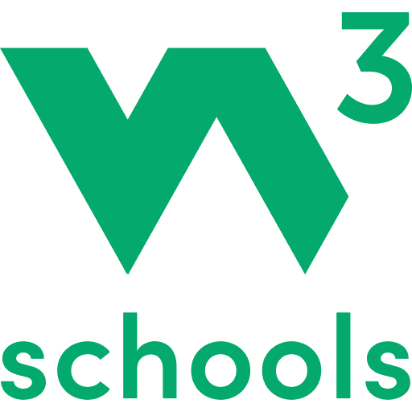

# Sumber Belajar SQL

Saya rekomendasikan dan melakukan riset kecil-kecilan ada tujuh sumber untuk belajar dan berlatih SQL yang sangat powerful dan anda semua ini dipelajari oleh beberapa perusahaan besar, dari tutorial pemula hingga latihan soal dan dokumentasi resmi. Enam platform masih sangat relevan dengan dunia industri sekarang. Sumber ketujuh adalah dokumentasi PostgreSQL sebagai referensi sintaks dan perilaku database.anda tidak perlu mengeluarkan source lebih banyak lagi.pelajari sekarang,ini waktunya.!!!

## 1. HackerRank — latihan SQL

[HackerRank SQL](https://www.hackerrank.com/domains/sql) menyediakan tantangan coding berjenjang. Topiknya melatih dasar pengambilan dan penyaringan data hingga agregasi, JOIN, dan query yang lebih kompleks.

**Manfaat:** berlatih memecahkan soal dengan format input dan output yang jelas, sekaligus membangun rutinitas latihan. Mulailah dari level dasar dan pastikan memahami alasan query menghasilkan jawaban tersebut.

## 2. W3Schools — tutorial interaktif SQL

[W3Schools SQL Tutorial](https://www.w3schools.com/sql/) menjelaskan konsep dan sintaks dengan contoh singkat serta editor yang dapat dicoba. Materinya meliputi SELECT, WHERE, ORDER BY, fungsi agregat, JOIN, dan operasi tabel.

**Manfaat:** cocok sebagai pengantar cepat bagi pemula untuk membaca contoh dan mencoba query. Periksa dialek database yang digunakan karena beberapa sintaks dapat berbeda antara MySQL, PostgreSQL, dan sistem lainnya.

## 3. LeetCode — SQL 50 dan soal wawancara

[LeetCode SQL 50](https://leetcode.com/studyplan/top-sql-50/) menyajikan kumpulan soal SQL untuk melatih pemecahan masalah. Latihan mencakup filtering, JOIN, agregasi, fungsi tanggal, dan konsep SQL lainnya.

**Manfaat:** membantu melatih penalaran query dan mempersiapkan diri menghadapi soal teknis. Kerjakan soal sendiri terlebih dahulu, lalu bandingkan pendekatan dan pelajari kasus-kasus batas.

## 4. SQLBolt — belajar sambil mencoba query

[SQLBolt](https://sqlbolt.com/) menyajikan pelajaran ringkas dan latihan interaktif langsung di browser. Materi disusun bertahap dari SELECT dan filter hingga JOIN serta perubahan data.

**Manfaat:** pilihan praktis untuk mulai belajar tanpa menyiapkan database lokal. Ikuti urutan pelajaran agar konsep dasar terbentuk sebelum masuk ke query yang lebih kompleks.

## 5. SQLZoo — tutorial dan latihan SQL

[SQLZoo](https://sqlzoo.net/) menyediakan tutorial dan kuis interaktif untuk mempraktikkan query. Materinya berkembang dari SELECT dan kondisi hingga JOIN, agregasi, dan topik lanjutan.

**Manfaat:** memperkuat pemahaman dengan latihan langsung setelah mempelajari konsep. Jika hasil atau sintaks berbeda dari database yang digunakan, periksa kemungkinan perbedaan dialek SQL.

## 6. Mode — SQL Tutorial

[Mode SQL Tutorial](https://mode.com/sql-tutorial/) mengajarkan SQL melalui rangkaian tutorial dan contoh analisis data. Materinya membahas query dasar, agregasi, JOIN, subquery, dan teknik analisis yang umum dipakai saat bekerja dengan data.

**Manfaat:** membantu menghubungkan sintaks SQL dengan pertanyaan analitis. Gunakan latihan untuk membangun query yang menjawab kebutuhan analisis, bukan sekadar menghafal perintah.

## 7. Dokumentasi resmi PostgreSQL

[Dokumentasi PostgreSQL](https://www.postgresql.org/docs/) adalah referensi resmi untuk sintaks, tipe data, fungsi, dan fitur PostgreSQL. Dokumentasi ini berguna ketika membutuhkan penjelasan yang tepat tentang perilaku database yang digunakan.

**Manfaat:** menjadi rujukan tepercaya saat query melibatkan fitur khusus PostgreSQL atau ketika tutorial umum tidak menjelaskan detail yang diperlukan. Pilih versi dokumentasi yang sesuai dengan versi PostgreSQL yang dipakai.

## Urutan belajar yang disarankan

1. Mulai dengan W3Schools atau SQLBolt untuk memahami `SELECT`, `FROM`, `WHERE`, dan pengurutan.
2. Perkuat dasar melalui latihan SQLZoo dan HackerRank.
3. Pelajari agregasi (`GROUP BY`, `HAVING`), JOIN, subquery, dan fungsi window secara bertahap.
4. Gunakan Mode untuk mempraktikkan query dalam konteks analisis data.
5. Kerjakan soal LeetCode untuk mengasah pemecahan masalah dan persiapan wawancara.
6. Rujuk dokumentasi PostgreSQL untuk memeriksa sintaks dan fitur spesifik PostgreSQL.
7. Terapkan materi pada dataset nyata dan tuliskan pertanyaan analisis serta kesimpulan yang didukung oleh hasil query.

## Tips latihan

- Pahami bentuk hasil yang diminta sebelum menulis query.
- Pecah query kompleks menjadi langkah-langkah kecil dan validasi hasil setiap langkah.
- Uji nilai kosong, duplikasi, dan kondisi batas.
- Format query dengan rapi dan gunakan alias yang menjelaskan arti kolom.
- Catat perbedaan dialek SQL saat berpindah database.
- Gunakan hasil latihan sebagai bahan belajar; jangan hanya menyalin jawaban tanpa memahami logikanya.

> Ikon merupakan tautan ke situs terkait. Materi, fitur, dan ketentuan layanan dapat berubah. Periksa situs resmi untuk informasi terkini.
